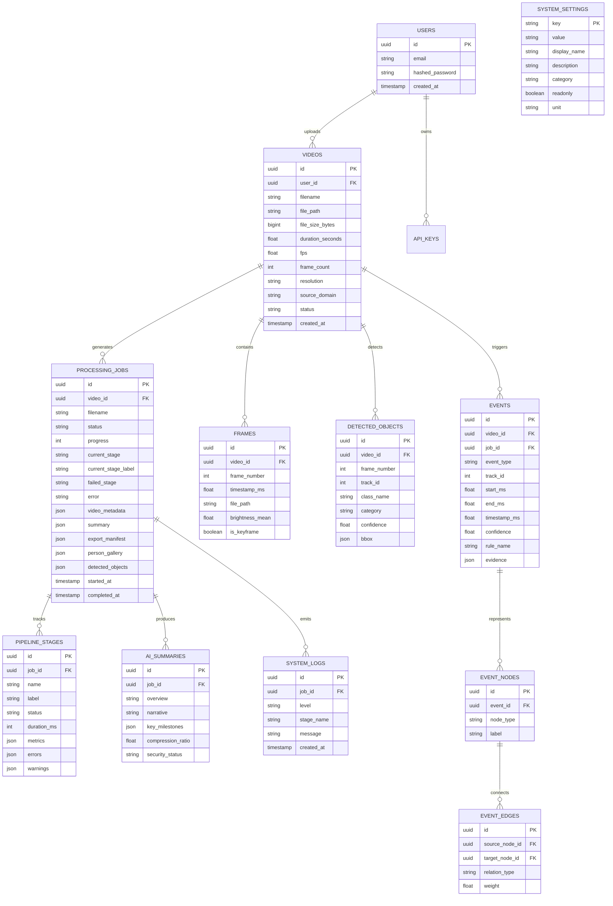

# 🧠 Software Requirements Specification (SRS) Input & Reference Document
## Project: Time Compression Engine (TCE v1.0.1 / v1.1)

> **Instructions for Claude / LLM Generating the Official SRS:**
> 1. Use the exhaustive technical specifications, architectural models, mathematical formulas, interface definitions, database schemas, and empirical benchmark data below to generate a formal **IEEE Std 830-1998 / ISO/IEC/IEEE 29148:2018 compliant Software Requirements Specification (SRS)** document.
> 2. **Strict Non-Hallucination Invariant**: Do NOT invent or fabricate any features, microservices, cloud vendors, frameworks, or performance metrics not documented herein. All models, versions, endpoints, algorithms, and capabilities must strictly reflect the active repository code and measured benchmarks.
> 3. Preserve the explicit distinction between **Category A (Empirically Validated)**, **Category B (Implemented & Exercised)**, and **Category C (Planned / Future Work / Out of Scope)** capabilities.
> 4. Ensure all Functional Requirements (FRs), Non-Functional Requirements (NFRs), Interface Requirements, and Data Constraints are uniquely numbered (e.g., `FR-S01-001`, `NFR-PERF-001`).

---

## 1. Introduction & Executive Overview

### 1.1 Purpose
The purpose of this document is to specify the complete software requirements for the **Time Compression Engine (TCE v1.0.1 / v1.1)**. TCE is a patent-grade, research-caliber video intelligence and semantic temporal compression system designed to condense hours of continuous surveillance CCTV footage into causal, narrative-preserving video summaries, multi-actor ReID tracking dossiers, and deep physical scene inventories.

### 1.2 Problem Statement & Core Value Proposition
Surveillance operators, security teams, and forensic investigators face an intractable data scaling bottleneck: **reviewing 24 hours of multi-camera CCTV footage takes an unsustainable amount of human attention**.
- Standard video codecs ($H.264$, $H.265$, $AV1$) achieve spatial and temporal bitrate compression by eliminating pixel-level perceptual redundancy, but leave the total playback duration unchanged.
- Naive video summarizers extract isolated motion bursts or simple object detections, severing causal human narrative (e.g., showing a subject running without recording who they interacted with or what doorway they entered).
- **The TCE Solution**: TCE reframes the problem as **Semantic Temporal Compression**. Video is converted into a Directed Causal Event Graph $G = (V, E)$, compressing temporal playback while enforcing **Narrative Chain Atomicity** ($\text{Entry} \to \text{Action/Interaction} \to \text{Exit}$), ensuring no causal prerequisite is severed.

### 1.3 Core Innovations & Inventions
1. **Narrative Chain Atomicity**: Under target temporal compression budgets (e.g., $40\%$ budget or $100:1$ ratio), entire causal story sequences are preserved intact rather than sliced into disjointed fragments.
2. **Context-Gated Kinematic Reasoning (`SceneStairGuard`)**: Resolves false perspective depth drift (walking toward a camera mimicking 2D vertical elevation changes) by dynamically evaluating $1.5\times$ Person Regions of Interest ($\text{ROI}$) using open-vocabulary vision (`YOLO-World v2`) with Intersection-over-Person ($\text{IoP}$) and temporal persistence gating.
3. **Multi-Source Calibrated Confidence Fusion**: Replaces single brittle neural network confidence thresholds with a calibrated 5-factor linear fusion across detection, motion kinematics, rule satisfaction, Kalman tracking stability, and scene reliability.
4. **Actor Re-Identification (ReID) Dossier System**: Reconstructs continuous occupant identities across occlusions and field-of-view re-entries using MobileNetV3 with L2-normalized metric embeddings.
5. **Structured Explainability Chains**: Every event classification, inclusion, or exclusion decision attaches a machine-readable audit trail documenting individual detector confidence, motion scores, spatial relations, and rule paths.

### 1.4 Product Scope & Boundary Definitions
- **In Scope (Current Implementation)**: Single-camera continuous CCTV video ingestion, chunked frame extraction, adaptive histogram scene detection, YOLO11 object detection, Kalman/Hungarian tracking, MobileNetV3 ReID, 18-rule domain semantic reasoning, pose keypoint analysis, directed event graphs, chain atomicity compression, FFmpeg highlight stitching, Next.js 14 HUD cinema player, and REST API.
- **Out of Scope (Explicitly Deferred)**: Live 24-hour circular stream buffering, multi-camera cross-angle pedestrian hand-off across non-overlapping views, and 3D dense transformer action recognition (e.g., VideoMAE).

---

## 2. Overall System Description & High-Level Architecture

### 2.1 The Three-Engine Decoupled Architecture
TCE strictly decouples video summarization into three specialized intelligence layers:

```mermaid
graph TD
    %% Inputs
    RawVideo[Raw CCTV Video Input] --> S01[S01: Upload & Ingestion]
    
    %% Perception Engine
    subgraph Perception Engine ["Perception Intelligence Engine (Pixels → Signals)"]
        S01 --> S02[S02: Frame Extraction]
        S02 --> S03[S03: Scene Detection]
        S03 --> S04[S04: Object Detection YOLO11]
        S04 --> S05[S05: Tracking ByteTrack + ReID MobileNetV3]
        S05 --> S06[S06: Motion Analysis & Camera Homography]
    end
    
    %% Semantic Intelligence Engine
    subgraph Semantic Engine ["Semantic Intelligence Engine (Signals → Events)"]
        S06 --> S07[S07: Semantic Event Understanding & Stair Guard]
        S07 --> S08[S08: Calibrated Confidence Fusion]
    end
    
    %% Temporal Intelligence Engine
    subgraph Temporal Engine ["Temporal Intelligence Engine (Events → Narrative)"]
        S08 --> S09[S09: Story Building & Event Graph G=(V,E)]
        S09 --> S10[S10: Narrative & Importance Ranking]
        S10 --> S11[S11: Summarization Policy & Chain Atomicity]
        S11 --> S12[S12: Export, FFmpeg Slicing & Manifest]
    end
    
    %% Outputs
    S12 --> UI[Next.js 14 Forensic Cinema Dashboard]
    S12 --> API[FastAPI REST Endpoints]
    S12 --> Artifacts[MP4 Clips, JPEG Thumbs, JSON Manifests]
```

### 2.2 End-to-End Pipeline Stages (S01–S12)
The engine executes a sequential directed pipeline coordinated by `PipelineOrchestrator` using a shared `PipelineContext` dataclass:

1. **S01 — Upload & Validation (`s01_upload.py`)**: Validates video containers (MP4, AVI, MOV, MKV, WEBM), executes `ffprobe` metadata extraction (duration, FPS, resolution, codec, frame count), generates poster previews, and rejects corrupted files.
2. **S02 — Frame Extraction (`s02_extract.py`)**: Deterministic stride extraction via FFmpeg filter `select='not(mod(n, N))'` (default $5\times$ skip / $\sim 6$ FPS) with MOG2 motion-adaptive keyframe densification.
3. **S03 — Scene Change Detection (`s03_scene_detect.py`)**: Adaptive rolling histogram difference (HSV Pearson correlation) + normalized grayscale pixel difference with dynamic rolling window thresholding ($W=50$, $k=1.5$).
4. **S04 — Object Detection (`s04_object_detect.py`)**: Ultralytics YOLO11 inference (configurable: `yolo11n` fast, `yolo11l` balanced, `yolo11x` accuracy) with automated CLAHE low-light contrast enhancement.
5. **S05 — Multi-Object Tracking & ReID (`s05_track.py`)**: Kalman filter motion prediction + Hungarian IoU matching ($O(n^3)$) with lifecycle state machine (`TENTATIVE` $\to$ `ACTIVE` $\to$ `LOST` $\to$ `ENDED`) and MobileNetV3 L2 appearance embeddings for persistent identity tracking across occlusions.
6. **S06 — Motion Analysis (`s06_motion_analyze.py`)**: Track centroid velocity estimation ($dx/dt, dy/dt$), speed categorization, 8-compass direction classification, approach/recede bounding area tracking, and global camera homography motion suppression.
7. **S07 — Semantic Event Understanding (`s07_event_understand.py`)**: 7-pass multi-modal event detection:
   - *Pass 1*: Track entry, exit, walking, and loitering rules.
   - *Pass 2*: Brightness luminance signal analysis (lighting transitions).
   - *Pass 3*: YOLOv8-Pose / YOLO11x-Pose 17-keypoint posture and gesture recognition.
   - *Pass 3b*: `TemporalPoseAnalyzer` bounding-box geometry state machine (crawling, crouching, falling, running).
   - *Pass 5*: `ActivityStateMachine` track trajectory transitions (eliminates duplicate jitter).
   - *Pass 6*: `InteractionDetector` person-object interaction (laptops, phones, drinks, books, bags).
   - *Pass 6b*: Scene security detector (unattended bags, group gatherings).
   - *Pass 7*: Narrative enrichment, `SceneStairGuard` open-vocabulary elevation verification, cycling sanity gating, and person-label injection.
8. **S08 — Confidence Fusion (`s08_confidence_fuse.py`)**: Computes a 5-dimensional `ConfidenceVector` ($w_{det}=0.30$, $w_{mot}=0.25$, $w_{rule}=0.20$, $w_{track}=0.15$, $w_{scene}=0.10$) and discards events below threshold ($\tau=0.35$).
9. **S09 — Story Building (`s09_story_build.py`)**: Constructs Directed Event Graph $G = (V, E)$ via NetworkX with `SAME_TRACK_TEMPORAL` and `CO_OCCURRENCE` edges; classifies story completeness (`COMPLETE`, `PARTIAL`, `MINIMAL`).
10. **S10 — Importance Ranking (`s10_rank.py`)**: Multi-factor scoring combining visual importance ($w=0.40$) and narrative completeness/coherence ($w=0.60$).
11. **S11 — Summarization Policy (`s11_summarize.py`)**: Enforces Chain Atomicity under target time compression budgets ($0.40$ target), ensuring entire causal chains are kept or discarded together.
12. **S12 — Export & Packaging (`s12_export.py`)**: Generates annotated JPEG thumbnails, before/event/after context frames, slices individual MP4 highlight clips via FFmpeg, validates narrative continuity via `NarrativeValidator`, and writes `export_manifest.json`.

---

## 3. Technology Stack & Execution Environment

### 3.1 Backend Specifications
- **Programming Language**: Python 3.11 – 3.14 (fully verified on Windows & Linux).
- **API Framework**: FastAPI 0.111.0 with Uvicorn 0.29.0 ASGI server.
- **Data Validation & Settings**: Pydantic 2.7.0 & Pydantic-Settings 2.3.0.
- **ORM & Database**: SQLAlchemy 2.0.30, Alembic 1.13.1, asyncpg 0.29.0.
- **Active Repositories**: Async In-Memory Repository architecture (`get_video_repo`, `get_job_repo`, `get_event_repo`) with production SQLAlchemy ORM models.
- **Deep Learning & Computer Vision**:
  - PyTorch 2.13+cu132 / CUDA 12.x / 13.x.
  - Torchvision 0.18+.
  - Ultralytics 8.0+ (YOLO11n, YOLO11l, YOLO11x, YOLO11x-pose, YOLOv8n-pose).
  - Open-Vocabulary Perception: `yolov8l-worldv2.pt`.
  - Feature Embedding: MobileNetV3 (L2 normalized feature embeddings).
  - Image Processing: OpenCV (`cv2`), Pillow 10.3.0, NumPy 1.26.0.
  - Scientific Computing: SciPy 1.13.0 (`linear_sum_assignment` for Hungarian matching).
  - Graph Theory: NetworkX 3.x.
- **Multimedia Engine**: FFmpeg / FFprobe (executable wrapper with automatic Windows WinGet path patching).

### 3.2 Frontend Specifications
- **Framework**: Next.js 14.2.23 (React 18, App Router).
- **Language**: TypeScript 5.x.
- **Styling**: Tailwind CSS 3.4.1 (Cyberpunk / Forensic Dark HUD theme, Glassmorphism design tokens).
- **Animation**: Framer Motion 11.18.2.
- **UI Components**: Radix UI primitives (`@radix-ui/react-dialog`, `@radix-ui/react-tabs`, `@radix-ui/react-progress`, `@radix-ui/react-scroll-area`), Lucide React 0.474.0.
- **State Management & Client**: Typed API Client (`lib/api/client.ts`), Zustand 5.0.3.
- **Charts & Visualization**: Recharts 2.15.1.

### 3.3 Infrastructure & Containerization
- **Containerization**: `docker-compose.yml` defining 4 services:
  - `db`: PostgreSQL 16 Alpine (`tce_postgres`, port 5432).
  - `redis`: Redis 7 Alpine (`tce_redis`, port 6379).
  - `backend`: FastAPI Python container (port 8000).
  - `frontend`: Next.js Node container (port 3000).
- **Hardware Profile (Empirically Benchmarked)**:
  - NVIDIA GeForce RTX 5050 Laptop GPU (sm_120 Blackwell architecture, 8 GB VRAM).
  - Validated Peak VRAM Footprint: **983 MB**.
  - Validated Throughput: **$0.199$ Real-Time Factor ($5.03\times$ faster than playback)**.

---

## 4. Functional Requirements (FR)

### 4.1 Ingestion & Preprocessing (Perception Engine)
- **`FR-S01-001` (Container Ingestion)**: The system MUST accept video files in MP4, AVI, MOV, MKV, and WEBM formats via multipart HTTP upload.
- **`FR-S01-002` (Metadata Probing)**: The system MUST execute `ffprobe` to extract duration, framerate, total frame count, resolution width/height, and video codec without decoding full streams.
- **`FR-S01-003` (Corruption Rejection)**: The system MUST intercept corrupted, zero-byte, or unreadable media files and abort processing with a `VideoCorruptedError` before stage execution.
- **`FR-S02-001` (Deterministic Extraction)**: The system MUST extract frames using deterministic stride sampling (`select=not(mod(n, N))`) guaranteeing bit-identical frame extraction across repeated runs.
- **`FR-S02-002` (Adaptive Frame Sampling)**: The system MUST support background motion-adaptive sampling via MOG2 foreground masking, skipping static background frames while preserving high-motion keyframes.
- **`FR-S03-001` (Scene Boundary Classification)**: The system MUST calculate composite visual difference using 40% normalized grayscale pixel difference and 60% HSV histogram correlation Pearson difference.
- **`FR-S03-002` (Adaptive Thresholding)**: The system MUST maintain a rolling window of $W=50$ frames and flag scene boundaries when composite difference exceeds $\mu + 1.5\sigma$.
- **`FR-S04-001` (Model Profile Support)**: The system MUST support three discrete processing profiles:
  - `fast`: YOLO11n detection, pose disabled, measured at 80 FPS, 44 MB VRAM.
  - `balanced`: YOLO11l detection, YOLOv8n-pose, measured at 32 FPS, 183 MB VRAM.
  - `accuracy`: YOLO11x detection, YOLO11x-pose, measured at 32 FPS, 392 MB VRAM.
- **`FR-S04-002` (Low-Light Contrast Enhancement)**: The system MUST evaluate mean frame luminance and apply Contrast Limited Adaptive Histogram Equalization (CLAHE) when luminance falls below threshold.
- **`FR-S05-001` (Kalman-Hungarian Tracking)**: The system MUST assign persistent integer Track IDs to physical objects using Hungarian maximum-overlap bipartite matching over IoU cost matrices.
- **`FR-S05-002` (Track Confirmation Lifecycle)**: The system MUST gate raw bounding boxes through a state machine requiring $\ge 3$ consecutive matches before transitioning `TENTATIVE` tracks to `ACTIVE`, suppressing single-frame false alarms.
- **`FR-S05-003` (Multi-Actor Appearance ReID)**: The system MUST extract MobileNetV3 appearance embeddings, normalize them via L2 norm, and cluster identities across re-entries into unified person entities (`Person 1`, `Person 2`, etc.).
- **`FR-S06-001` (Kinematic Trajectory Vectors)**: The system MUST compute velocity vectors ($\Delta x / \Delta t, \Delta y / \Delta t$), speed classifications (stationary, slow, walking, fast), and 8-compass directions for every active track.
- **`FR-S06-002` (Camera Homography Compensation)**: The system MUST identify coherent global motion across background tracks and suppress perspective-induced spurious motion events during camera pans or shakes.

### 4.2 Semantic Intelligence & Rule Engines
- **`FR-S07-001` (Multi-Pass Event Understanding)**: The system MUST execute 7 analysis passes producing unified `Event` schema objects with mandatory `evidence` dictionaries.
- **`FR-S07-002` (Posture & Gesture Recognition)**: The system MUST evaluate 17-keypoint skeletal landmarks to classify sitting, standing, walking, and reaching up.
- **`FR-S07-003` (Temporal Posture State Machine)**: The system MUST evaluate aspect-ratio kinematics over rolling windows to detect sustained crawling, crouching, falling, and running with hysteresis filtering.
- **`FR-S07-004` (Context-Gated Stair Guard)**: When evaluating vertical elevation trajectories (`walking_upstairs`, `walking_downstairs`), the system MUST crop a dynamic $1.5\times$ Person ROI, query `yolov8l-worldv2` for staircase presence, calculate Intersection-over-Person ($\text{IoP}$), evaluate temporal persistence ($\ge 2$ observations), and suppress false stairs if final stair confidence is $< 0.55$.
- **`FR-S07-005` (Interaction Detection)**: The system MUST detect object interactions (laptop usage, mobile phone interaction, beverage drinking, reading, bag placement) via spatial bounding-box overlap and temporal proximity.
- **`FR-S07-006` (Physical Scene Inventorying)**: The system MUST catalogue office and commercial hardware (computer monitors, keyboards, mice, CPU towers, chairs, desks) with instance counts, maximum confidence scores, and first-seen timestamps.
- **`FR-S08-001` (Calibrated Confidence Fusion)**: The system MUST calculate a fused confidence score:
  $$C_{fused} = 0.30 \cdot C_{det} + 0.25 \cdot C_{mot} + 0.20 \cdot C_{rule} + 0.15 \cdot C_{track} + 0.10 \cdot C_{scene}$$
  and discard candidate events scoring below $0.35$.

### 4.3 Temporal Intelligence & Story Preservation
- **`FR-S09-001` (Directed Event Graph)**: The system MUST construct a Directed Event Graph $G=(V, E)$ linking events by `SAME_TRACK_TEMPORAL` and `CO_OCCURRENCE` (within $2000$ ms sliding window).
- **`FR-S09-002` (Story Arc Segmentation)**: The system MUST segment event streams into actor-centric story arcs and classify their completeness:
  - `COMPLETE`: Contains entry transition, substantive action/interaction, and exit transition.
  - `PARTIAL`: Contains action/interaction but lacks entry or exit boundary.
  - `MINIMAL`: Single isolated observation or boundary event.
- **`FR-S10-001` (Multi-Factor Narrative Ranking)**: The system MUST score each story segment combining visual importance ($w=0.40$) and narrative completeness/coherence ($w=0.60$).
- **`FR-S11-001` (Chain Atomicity Preservation)**: The compression policy engine MUST enforce chain atomicity such that complete story sequences are either fully retained or fully discarded, never truncated into partial fragments.
- **`FR-S11-002` (Compression Budget Optimizer)**: The system MUST iteratively select highest-ranked story segments until the cumulative duration matches the user-specified target compression budget (default $0.40$).
- **`FR-S12-001` (Video Slicing & Export)**: The system MUST invoke FFmpeg to slice individual MP4 event highlight clips and generate static JPEG event thumbnails and before/event/after context frames.
- **`FR-S12-002` (Export Manifest Generation)**: The system MUST serialize a complete `export_manifest.json` detailing all preserved events, clip paths, thumbnail URLs, processing durations, and narrative validation scores.

---

## 5. External Interface & API Specification

Base REST Path: `/api/v1`

### 5.1 Route Inventory & Contracts

| HTTP Method | Endpoint Path | Tag | Description & Contract |
| :--- | :--- | :--- | :--- |
| `GET` | `/health` | `health` | System status, GPU device info (CUDA/CPU, VRAM, device name), loaded models, and pipeline version. |
| `POST`| `/upload` | `upload` | Multipart video file upload. Parameters: `file` (UploadFile), `source_domain` (str), `model_profile` (`fast`, `balanced`, `accuracy`). Returns `job_id`, `video_id`, and probed metadata. |
| `GET` | `/videos` | `videos` | List all ingested videos with duration, resolution, fps, and processing status. |
| `GET` | `/videos/{videoId}` | `videos` | Get detailed video record by ID. |
| `GET` | `/videos/{videoId}/stream` | `videos` | **HTTP 206 Partial Content** range-request video streaming endpoint for smooth HTML5 video playback. |
| `GET` | `/jobs` | `jobs` | List all processing jobs. |
| `GET` | `/jobs/{jobId}` | `jobs` | Real-time stage execution progress ($S01 \to S12$), stage runtimes, current stage, and log buffer. |
| `GET` | `/jobs/{jobId}/diagnostics` | `diagnostics`| Per-stage runtime metrics, frame extraction rates, detection counts, and export statistics. |
| `GET` | `/jobs/{jobId}/evaluation` | `diagnostics`| Structured `EvaluationMatrix` for research benchmarking. |
| `GET` | `/timeline/{videoId}` | `timeline` | Full forensic timeline payload: 6-person ReID gallery, categorized events (activity, lighting, interaction, vehicle), physical object inventory, and plain-language executive narrative. |
| `GET` | `/timeline/crops/{jobId}/{filename}` | `timeline` | Static file serving for actor portrait crops and contextual detection crops. |
| `GET` | `/events` | `events` | Query fused events across processed videos with filters for `video_id`, `min_confidence`, and pagination. |
| `GET` | `/events/{eventId}/thumbnail` | `events` | Serves annotated event keyframe JPEG. |
| `GET` | `/events/{eventId}/clip` | `events` | Streams or downloads sliced MP4 highlight video clip. |
| `GET` | `/stories/{videoId}` | `stories` | Grouped story arcs per identified actor/track with temporal boundaries, completeness state, and event counts. |
| `GET` | `/event-graph/{videoId}` | `event_graph` | Network graph structure: actor nodes, co-occurrence edges, and degree centrality statistics. |
| `GET` | `/summary/{videoId}` | `summary` | Natural-language AI summary, milestone sequence table, and compression statistics. |
| `GET` | `/analytics` | `analytics` | High-level system performance metrics: total videos, total events, average compression ratio, total bytes. |
| `GET` | `/settings` | `settings` | Read-only inspection of frozen `TCE_V1_REFERENCE` pipeline parameters. |
| `GET` | `/models` | `models` | Model registry status and loaded weights. |
| `GET` | `/debug/status` | `debug` | In-memory repository dumps and diagnostic health data. |
| Static Mount | `/outputs/*` | `StaticFiles` | Static file mount serving thumbnails, sliced clips, and annotated frames directly from disk. |

---

## 6. Data Models & Database Schema

The system defines 12 core SQLAlchemy ORM models mapped to PostgreSQL (with UUID primary keys) and mirrors them in async in-memory repositories for local runtime execution:



---

## 7. User Interface & Frontend Requirements

The frontend is implemented in Next.js 14 App Router with 8 primary views:

1. **Main Dashboard (`/`)**:
   - System telemetry overview: active processing jobs, total processed videos, average compression ratio, total bytes ingested.
   - Job queue table with live progress bars, stage badges, and direct navigation links.
   - Recent detected events stream with confidence rings and actor badges.
2. **Video Ingestion Hub (`/upload`)**:
   - Drag-and-drop video upload zone powered by `react-dropzone`.
   - Domain selector (`cctv_indoor`, `office`, `parking_lot`, `entrance`).
   - Model Profile selector (`fast`, `balanced`, `accuracy`) displaying measured FPS and VRAM.
   - Instant transition to live job progress tracking upon upload submission.
3. **Pipeline Telemetry Monitor (`/processing/[jobId]`)**:
   - 12-stage animated stepper displaying real-time status (`pending`, `running`, `success`, `failed`).
   - Live streaming terminal log buffer updating via SSE/polling.
   - Collapsible `DiagnosticsPanel` detailing per-stage durations and GPU memory load.
4. **Forensic Cinema Timeline (`/timeline/[videoId]`)**:
   - `CinemaVideoPlayer`: Synchronized HTML5 video player with dynamic HUD bounding box overlays, timeline scrub bar, and one-click track seeking.
   - **Multi-Actor ReID Dossier Gallery**: Carousel of detected actors (`Person 1` through `Person 6`) displaying portrait crops, context crops, dwell times, and entry directions.
   - **Person Dossier Drawer (`PersonDossierModal`)**: Deep modal inspecting an actor's observation count, associated track IDs, and complete timeline of actions.
   - **Deep Scene & Hardware Inventory**: Searchable grid of indexed office and commercial equipment (monitors, keyboards, mice, towers, chairs, desks) with instant video seek.
   - **Executive Narrative View**: Plain-language narrative summary and chronological milestone sequence table.
   - **Loss Prevention Status**: Visual badge indicating `SCENE SECURE` or alerting to suspicious asset removals.
5. **Video Events Hub (`/events`)**:
   - Section-wise video cards organizing events by video source.
   - Multi-parameter filter drawer: confidence slider ($0.0 \to 1.0$), actor dropdown, category filter (activity, lighting, interaction, vehicle).
   - Event preview trigger opening `EventPreviewModal` displaying before/event/after context frames and sliced MP4 highlight clips.
6. **Narrative Stories (`/stories`)**:
   - Chronological story arc cards grouped by actor identity.
   - Story completeness badges (`COMPLETE`, `PARTIAL`, `MINIMAL`) and narrative coherence scores.
7. **System Analytics (`/analytics`)**:
   - Storage reduction statistics, distribution of event types, and processing speed charts.
8. **Pipeline Settings (`/settings`)**:
   - Read-only inspector displaying frozen `TCE_V1_REFERENCE` constants across Detection, Tracking, Performance, Compression, Events, Story, Quality, and System categories.

---

## 8. Algorithmic Formulations & Mathematical Models

### 8.1 Frame Extraction Stride
$$\text{Filter} = \text{select}='not(mod(n, N))', \quad \text{setpts}=N / (\text{FPS} \cdot \text{TB})$$
Where $n$ is the source frame index and $N$ is the skip rate (default $N=5$).

### 8.2 Adaptive Scene Boundary Detection
$$\Delta_{pixel}(t) = \frac{1}{255 \cdot W \cdot H} \sum_{x,y} |I_{gray}(x,y,t) - I_{gray}(x,y,t-1)|$$
$$\Delta_{hist}(t) = 1.0 - \text{PearsonCorrelation}(H_{HSV}(t), H_{HSV}(t-1))$$
$$S_{composite}(t) = 0.4 \cdot \Delta_{pixel}(t) + 0.6 \cdot \Delta_{hist}(t)$$
$$\tau_{adaptive}(t) = \mu(S_{composite}[t-W:t]) + 1.5 \cdot \sigma(S_{composite}[t-W:t]), \quad W=50$$

### 8.3 Hungarian IoU Tracking Assignment
$$\text{CostMatrix}_{i,j} = 1.0 - \text{IoU}(\text{Box}_i, \text{Box}_j) = 1.0 - \frac{\text{Area}(\text{Box}_i \cap \text{Box}_j)}{\text{Area}(\text{Box}_i \cup \text{Box}_j)}$$
Solved via Kuhn-Munkres algorithm in $O(n^3)$ time, gated by $\text{IoU} \ge 0.30$.

### 8.4 Context-Gated Elevation & Stair Guard
1. **Dynamic ROI Expansion**: Expand person bounding box by $1.5\times$:
   $$[x_1', y_1', x_2', y_2'] = [x_1 - 0.25w, y_1 - 0.25h, x_2 + 0.25w, y_2 + 0.25h]$$
2. **Open-Vocabulary Prompt Query**: Query `yolov8l-worldv2` over ROI with vocabulary `["stairs", "staircase", "steps"]`.
3. **Spatial Overlap Evaluation**:
   $$\text{IoP} = \frac{\text{Area}(\text{PersonBox} \cap \text{StairBox})}{\text{Area}(\text{PersonBox})}$$
4. **Decision Gating**:
   $$\text{StairVerified} = (C_{stair} \ge 0.55) \land (C_{scene\_stair} > 0.15) \land (\text{Persistence} \ge 2) \land (\text{IoP} > 0.05)$$
   If false, vertical displacement is suppressed as perspective depth drift and reclassified as walking.

### 8.5 Multi-Source Linear Confidence Fusion
$$C_{fused} = \sum_{k=1}^{5} w_k \cdot C_k, \quad \sum w_k = 1.0$$
$$\{w_{det}: 0.30, \; w_{mot}: 0.25, \; w_{rule}: 0.20, \; w_{track}: 0.15, \; w_{scene}: 0.10\}$$

### 8.6 Narrative Story Completeness & Graph Representation
- Directed Graph $G = (V, E)$ where vertices $v_i \in V$ represent semantic events and edges $e_{ij} \in E$ represent causal or temporal ties:
  - $e_{same\_track}$: Directed edge between consecutive events of the same track ($w=1.0$).
  - $e_{co\_occurrence}$: Undirected edge between concurrent events from distinct tracks occurring within $2000$ ms ($w=0.5$).
- Completeness State:
  $$\text{Completeness}(S) = \begin{cases} \text{COMPLETE} & \text{if } \text{has\_entry} \land \text{has\_action} \land \text{has\_exit} \\ \text{PARTIAL} & \text{if } \text{has\_action} \land (\text{has\_entry} \lor \text{has\_exit}) \\ \text{MINIMAL} & \text{otherwise} \end{cases}$$

### 8.7 Narrative-Preserving Compression Objective
Maximize cumulative narrative importance under duration constraint $T_{budget}$:
$$\max_{S' \subseteq S} \sum_{s \in S'} \text{Rank}(s) \quad \text{subject to} \quad \sum_{s \in S'} \text{Duration}(s) \le T_{target}$$
$$\text{With Chain Atomicity Invariant}: \quad \forall e \in s, \quad e \in \text{Output} \iff s \in S'$$

---

## 9. Non-Functional Requirements (NFR)

### 9.1 Performance & Throughput
- **`NFR-PERF-001` (Real-Time Factor)**: The engine MUST achieve a Real-Time Factor ($\text{RTF}$) $\le 0.25$ ($> 4\times$ faster than playback) on an NVIDIA RTX 5050 Laptop GPU under the `balanced` profile. (Empirically measured: $\text{RTF} = 0.199$ / $5.03\times$).
- **`NFR-PERF-002` (VRAM Footprint)**: Peak GPU VRAM utilization MUST not exceed $1.5$ GB on $1080p$ footage. (Empirically measured: $983$ MB peak VRAM).
- **`NFR-PERF-003` (Pipeline Scalability)**: The engine MUST process continuous video segments up to 10 minutes ($595.2$ seconds / $17,839$ frames) in a single linear execution without memory accumulation or crashes.

### 9.2 Reliability & Software Quality
- **`NFR-REL-001` (Regression Stability)**: The full backend test suite MUST maintain a $100\%$ pass rate across all unit, integration, and regression tests. (Empirically measured: **693/693 tests passing**).
- **`NFR-REL-002` (Graceful Degradation)**: If an optional model (such as pose estimation or open-vocabulary stair detection) fails, the pipeline MUST log the warning and fall back to bounding-box geometric heuristics without terminating the job.
- **`NFR-REL-003` (Export Integrity)**: All generated MP4 clips and JPEG thumbnails MUST be validated for nonzero size and structural validity before the job is marked `completed`.

### 9.3 Security & Explainability
- **`NFR-SEC-001` (Explainability Audit Guarantee)**: Every single event included in or excluded from the final timeline MUST feature a structured evidence payload detailing bounding boxes, confidence vectors, decision paths, and rule triggers.
- **`NFR-SEC-002` (CORS & Static Isolation)**: The backend API MUST enforce configured CORS middleware and serve static video artifacts through explicit `/outputs` mount paths without exposing root system directories.

---

## 10. Empirical Validation Matrix & Proven Boundaries

To ensure zero hallucination, the SRS MUST categorize every capability into its proven readiness level as audited in `reports/TCE-v1.0-final-assessment.md`:

### Category A: Empirically Validated (100% Proven on Real Footage)
1. **Sub-Real-Time Throughput**: Operates at $\text{RTF} = 0.199$ ($5.03\times$ playback speed) on an RTX 5050 Laptop GPU.
2. **Stable 10-Minute Execution**: Full $595.23$s continuous video (`archive_001`, $17,839$ frames) processed through all 12 stages without errors.
3. **False Stair Elimination**: $69/69$ perspective-induced false stair triggers suppressed ($100\%$ suppression) on flat-ground surveillance footage.
4. **Independent Positive Stair Detection**: $25/25$ holdout staircase sequences correctly identified ($100\%$ recall, $100\%$ precision).
5. **Narrative Chain Atomicity**: $12/12$ complete narrative chains ($100\%$) preserved intact under lossy budget compression.
6. **Compression Budget Adherence**: Target ratio $0.400$ achieved at $0.398$ ($0.5\%$ variance).
7. **Camera Motion Detection**: 77 camera shake frames detected, suppressing 3 false perspective tracks.
8. **Export File Integrity**: 4,327 artifacts (117 MP4 clips, 117 thumbnails, 4,188 preview frames) exported with zero failures.

### Category B: Implemented & Exercised (Code Complete, Heuristically Functional)
1. **Pose Gestures & Postures** (`reaching_up`, `crouching`, `fallen`, `crawling`): Bounding-box and keypoint state machines function and trigger events, but lack per-frame XML ground-truth annotations to compute formal F1 metrics.
2. **Multi-Person Spatial Clustering** (`group_gathering`, `group_dispersing`): Evaluated by spatial distance rules; unbenchmarked against formal multi-person dataset.
3. **Low-Light CLAHE Enhancement**: Implemented in S04; verified on synthetic test frames, automatically bypassed on daylight footage.
4. **Adaptive Frame Skip**: Implemented in S02 and unit-tested; reference benchmark locked at fixed $5\times$ skip for strict comparability.

### Category C: Explicitly Unvalidated / Future Work / Out of Scope
1. **24-Hour Continuous Operation**: Validated up to 10 minutes. Continuous circular multi-hour ring buffering remains a future roadmap item.
2. **Cross-Camera Hand-Off**: Tracking pedestrians across non-overlapping CCTV camera angles is not implemented.
3. **Universal Action Recognition**: Uses kinematic rules and open-vocabulary scene perception; does not deploy heavy 3D action transformers (SlowFast/VideoMAE).

---

## 11. Complete UML Architectural Diagrams Reference

A dedicated companion document containing complete Mermaid UML specifications for every architectural diagram requested for the IEEE 830 SRS has been generated in [docs/UML_DIAGRAMS.md](file:///c:/Users/USER/time-compression-engine/docs/UML_DIAGRAMS.md).

It contains complete, verified diagrams for:
1. **Use Case Diagram**: Operator, Administrator, and FFmpeg/GPU automated actors with complete `<<include>>` and `<<extend>>` associations.
2. **Class Diagram**: Complete OOP hierarchy across `PipelineOrchestrator`, `Track`, `TrackBBox`, `TrackObservation`, `Event`, `SceneStairGuard`, `ConfidenceFuser`, `EventGraph`, `StorySegment`, `RankingEngine`, and `CompressionPolicy`.
3. **Sequence Diagrams**:
   - *Sequence 1*: End-to-End Ingestion, Background 12-Stage Execution, and Manifest Slicing.
   - *Sequence 2*: Forensic Cinema Video Player, HTTP 206 Range Streaming, and One-Click Actor Timestamp Seeking.
4. **Activity Diagrams**:
   - *Activity 1*: End-to-End Multi-Engine Processing Pipeline with Early Rejection & Fallbacks.
   - *Activity 2*: Context-Gated Perspective Elevation & Stair Guard Decision Logic.
5. **State Machine Diagrams**:
   - *State Machine 1*: Object Track Lifecycle (`TENTATIVE` $\to$ `ACTIVE` $\to$ `LOST` $\to$ `ENDED`).
   - *State Machine 2*: Job Processing Lifecycle (`QUEUED` $\to$ `RUNNING` $\to$ `COMPLETED`/`FAILED`).
   - *State Machine 3*: Narrative Story Completeness (`MINIMAL` $\to$ `ENTRY_ONLY`/`EXIT_ONLY` $\to$ `PARTIAL` $\to$ `COMPLETE`).
   - *State Machine 4*: Human Occupant Kinematics & Posture State Machine.
6. **Component Diagram**: Presentation, Application, 3-Engine Processing, and Persistence Subsystem Boundaries.
7. **Deployment Diagram**: Client Workstation, Host Docker Daemon Topography, NVIDIA RTX 5050 GPU direct access, and Mounted Persistent Storage.

