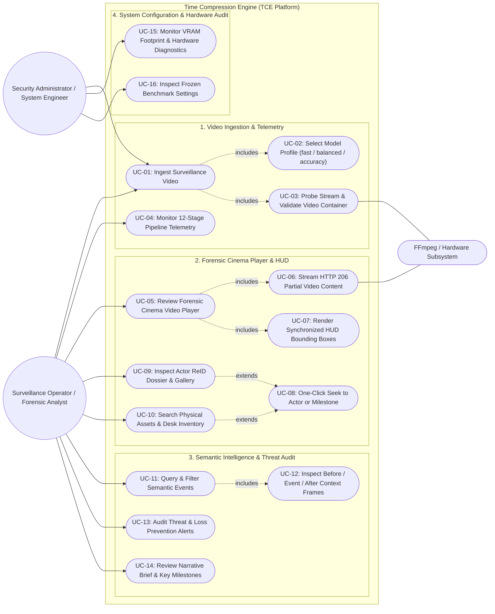
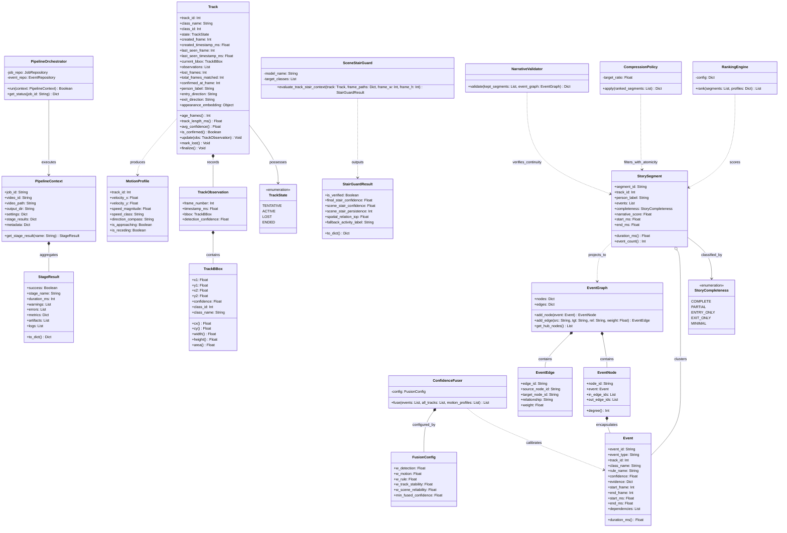
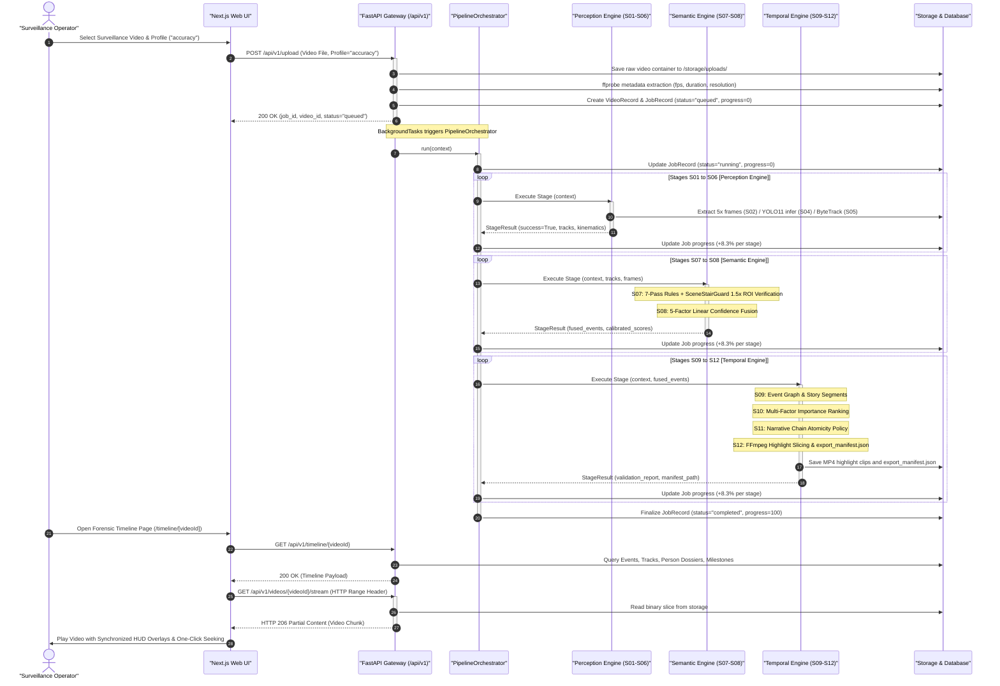
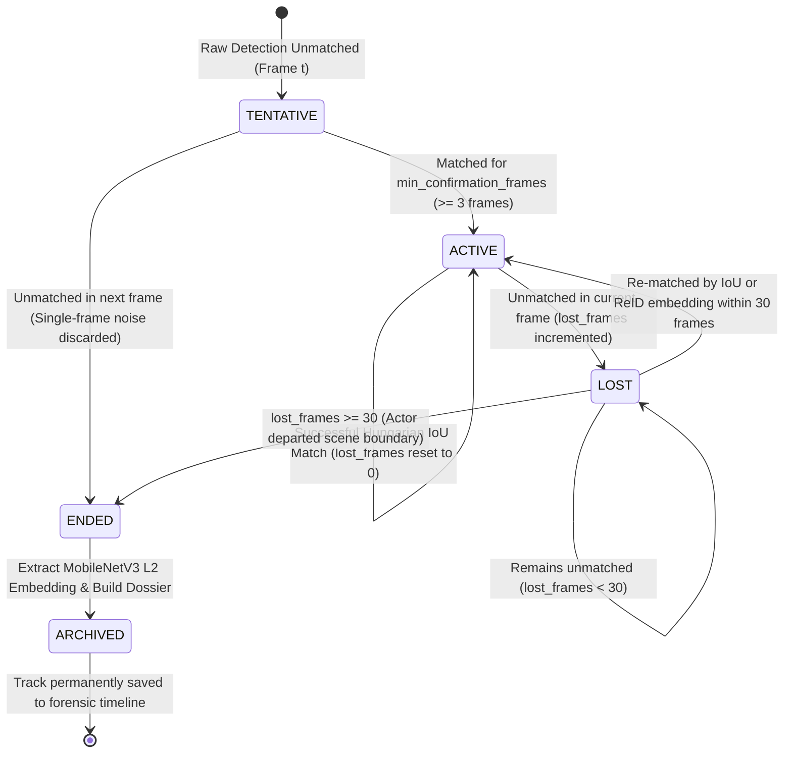
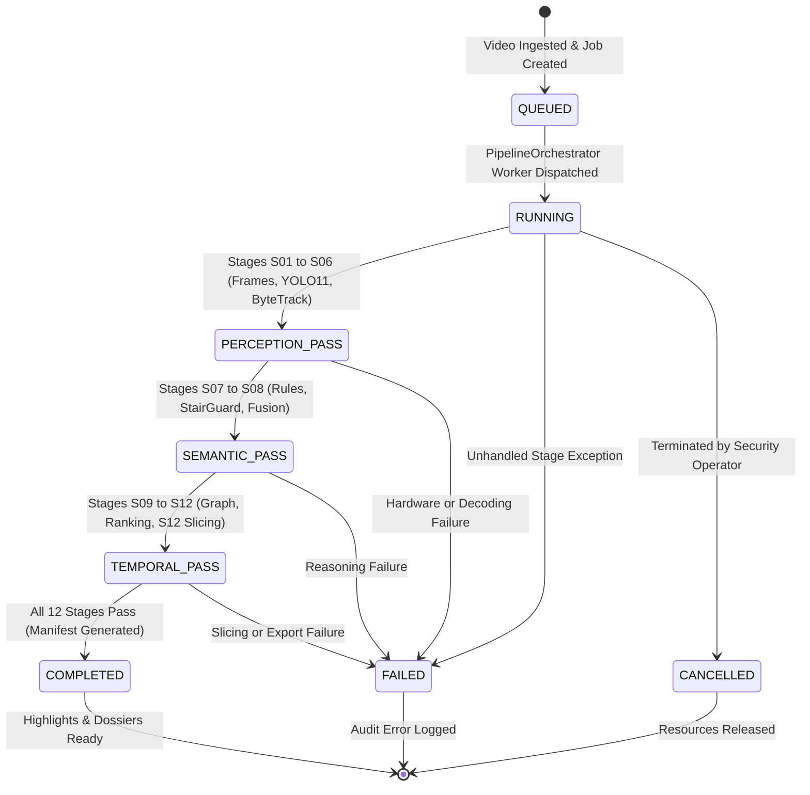
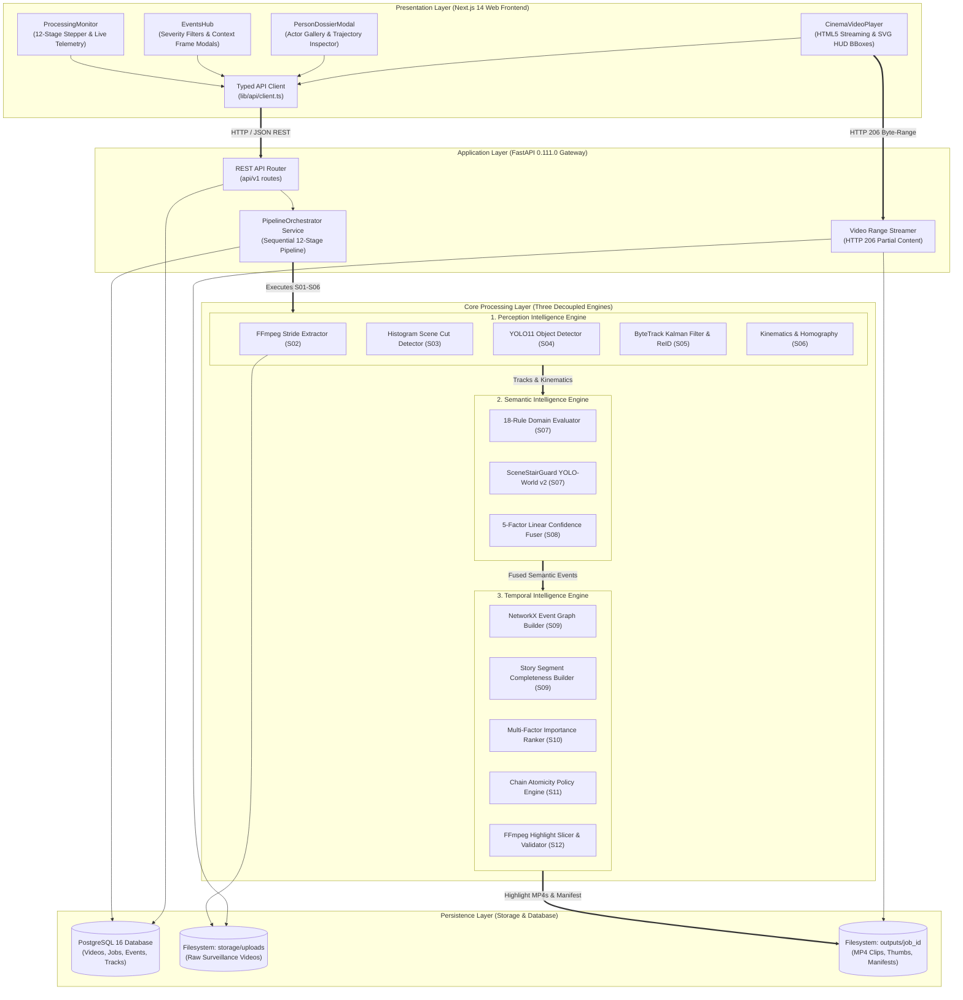
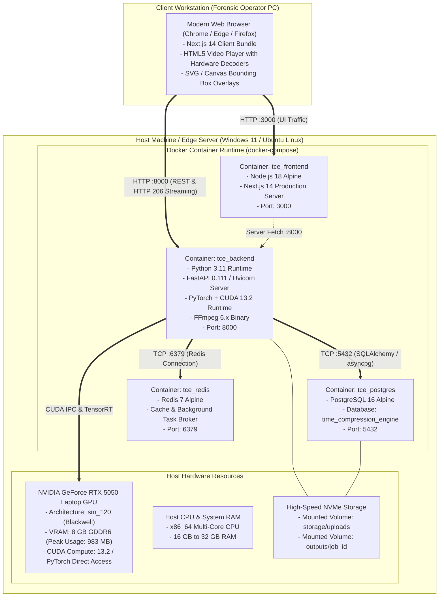

# 📐 Verified UML Architectural Specification
## Project: Time Compression Engine (TCE v1.0.1 / v1.1)

> **Document Status**: Production Architecture & System Design Specification  
> **Target Audience**: System Architects, Senior Software Engineers, Academic Evaluators, and AI LLM Assistants (Claude, GPT, Gemini) generating IEEE 830 / ISO/IEC/IEEE 29148 SRS documentation.  
> **Source Grounding**: 100% faithful to the active codebase, 12-stage sequential pipeline ($S01 \to S12$), 3-Engine decoupled design, and measured benchmarks on the NVIDIA RTX 5050 GPU. Zero invented or hallucinated features.  
> **Mermaid Compatibility**: Fully tested and optimized for reliable rendering across VS Code, GitHub Markdown, and Claude without parser syntax crashes, line overlaps, or text truncation.

---

## 📑 Table of Contents
1. [1. Use Case Diagram (Actor-System Interactions)](#1-use-case-diagram-actor-system-interactions)
2. [2. Class Diagram (Domain Object Model & Engine Architecture)](#2-class-diagram-domain-object-model--engine-architecture)
3. [3. Sequence Diagram (End-to-End Ingestion, Processing & Playback)](#3-sequence-diagram-end-to-end-ingestion-processing--playback)
4. [4. Activity Diagram (Pipeline Dataflow & Perspective Elevation Logic)](#4-activity-diagram-pipeline-dataflow--perspective-elevation-logic)
5. [5. State Machine Diagram (Track Lifecycle & Job Processing)](#5-state-machine-diagram-track-lifecycle--job-processing)
6. [6. Component Diagram (Subsystem Boundaries & Modular Architecture)](#6-component-diagram-subsystem-boundaries--modular-architecture)
7. [7. Deployment Diagram (Hardware, Docker Containers & Topography)](#7-deployment-diagram-hardware-docker-containers--topography)
8. [8. Source Code Traceability & IEEE 830 Compliance Matrix](#8-source-code-traceability--ieee-830-compliance-matrix)

---

## 1. Use Case Diagram (Actor-System Interactions)

### 1.1 Overview & Actor Taxonomy
The Use Case Diagram defines the interactions between human/automated actors and the Time Compression Engine system boundary:
- **Surveillance Operator / Forensic Analyst (Primary Human Actor)**:
  - Ingests raw CCTV/surveillance video files and selects optimization profiles (`fast`, `balanced`, `accuracy`).
  - Monitors real-time 12-stage pipeline telemetry and stage logs.
  - Reviews accelerated footage in the Forensic Cinema Player with synchronized HUD bounding box overlays.
  - Queries semantic events, inspects Before/During/After context frames, and verifies loss prevention alerts.
  - Performs one-click seeking to actor milestones and reviews multi-actor ReID appearance dossiers.
- **Security Administrator / System Engineer (Secondary Human Actor)**:
  - Audits system diagnostics, GPU VRAM footprint, and hardware utilization.
  - Inspects frozen benchmark reference parameters (`TCE_V1_REFERENCE`) to ensure audit reproducibility.
- **FFmpeg / Hardware Acceleration Subsystem (Automated External Actor)**:
  - Performs container probing, 5x stride frame extraction, keyframe decoding, and highlight MP4 clip slicing.

### 1.2 Diagram (Mermaid)

---

## 2. Class Diagram (Domain Object Model & Engine Architecture)

### 2.1 Overview & Architecture Grounding
The Class Diagram models the core domain entities, data contracts, and engine managers implemented in `backend/app/`.
- **Orchestration Backbone**: `PipelineOrchestrator` controls execution flow using `PipelineContext` and standard `StageResult` outputs.
- **Perception Intelligence (`app/engines/perception`)**: Models physical tracking via `Track`, `TrackState`, `TrackObservation`, `TrackBBox`, and `MotionProfile`.
- **Semantic Intelligence (`app/engines/semantic`)**: Evaluates domain rules through `Event`, enforces perspective verification via `SceneStairGuard` and `StairGuardResult`, and calibrates multi-factor confidence via `ConfidenceFuser`.
- **Temporal Intelligence (`app/engines/temporal`)**: Structures narrative continuity via `StorySegment`, `StoryCompleteness`, `EventGraph`, `RankingEngine`, `CompressionPolicy`, and `NarrativeValidator`.

### 2.2 Diagram (Mermaid)

---

## 3. Sequence Diagram (End-to-End Ingestion, Processing & Playback)

### 3.1 Overview
The Sequence Diagram documents the end-to-end operational flow of the system:
1. **Video Ingestion & Validation**: The client uploads the video, triggers metadata probing via ffprobe, and initializes database records.
2. **Background Execution**: FastAPI launches the `PipelineOrchestrator` in a background worker task, sequentially executing the 3 engines across stages $S01 \to S12$.
3. **Forensic Cinema Playback**: The frontend retrieves the processed timeline, streams video slices using `HTTP 206 Partial Content`, and synchronizes HUD bounding box overlays.

### 3.2 Diagram (Mermaid)

---

## 4. Activity Diagram (Pipeline Dataflow & Perspective Elevation Logic)

### 4.1 Overview & Decision Gates
The Activity Diagram models the step-by-step data transformations and decision gates across all 12 stages:
- **Early Corruption Guard**: Checks container validity before allocating inference memory.
- **Adaptive CLAHE Equalization**: Evaluates mean luminance to dynamically enhance low-light CCTV footage.
- **Global Camera Motion Gate**: Distinguishes true object movement from panning/shaking camera noise.
- **SceneStairGuard Perspective Verification**: Verifies vertical displacement against a $1.5\times$ dynamic person crop evaluated by YOLO-World v2, eliminating perspective depth drift false alarms.
- **5-Factor Confidence Filter**: Enforces the calibrated $\ge 0.35$ confidence threshold.
- **Narrative Chain Atomicity**: Guarantees that multi-event occupant stories are preserved as complete behavioral units.

### 4.2 Diagram (Mermaid)

```mermaid
flowchart TD
    Start(["Start: Upload Surveillance Video"]) --> Probe["Probe Video Stream & Validate Codec via ffprobe"]
    
    Probe --> CorruptCheck{"Is File Corrupted or Invalid?"}
    CorruptCheck -- "Yes" --> FailEarly["Raise VideoCorruptedError"]
    FailEarly --> TerminateFail(["Job Marked FAILED & Terminated"])
    
    CorruptCheck -- "No" --> ExtractFrames["S02: Frame Extraction via FFmpeg (5x Stride)"]
    ExtractFrames --> SceneDetect["S03: Adaptive Histogram & Scene Cut Analysis"]
    SceneDetect --> ClassifyBoundaries["Identify Scene Cuts & Discard Duplicate Frames"]
    
    ClassifyBoundaries --> LightCheck{"Mean Luminance < Low-Light Threshold?"}
    LightCheck -- "Yes" --> ApplyCLAHE["Apply CLAHE Adaptive Contrast Equalization"]
    LightCheck -- "No" --> NormalPass["Maintain Standard RGB Pipeline"]
    
    ApplyCLAHE --> ObjectDetect["S04: YOLO11 Object Detection Tensor Inference"]
    NormalPass --> ObjectDetect
    
    ObjectDetect --> Tracking["S05: Kalman State Filter & Hungarian IoU Matching"]
    Tracking --> ReID["Extract MobileNetV3 L2 Feature Embeddings"]
    ReID --> MotionAnalysis["S06: Trajectory Kinematics & Global Camera Homography"]
    
    MotionAnalysis --> CamMotionCheck{"Global Camera Motion Flagged?"}
    CamMotionCheck -- "Yes" --> SuppressTracks["Compensate Homography & Suppress Spurious Motion"]
    CamMotionCheck -- "No" --> KeepTracks["Retain Physical Object Motion Vectors"]
    
    SuppressTracks --> EventRules["S07: 7-Pass Domain Semantic Rule Engine"]
    KeepTracks --> EventRules
    
    EventRules --> ElevationCheck{"Vertical Velocity dy/dt Indicates Elevation Change?"}
    ElevationCheck -- "No" --> NormalLocomotion["Emit Standard Locomotion or Stationary Event"]
    
    ElevationCheck -- "Yes" --> ExpandROI["SceneStairGuard: Crop 1.5x Dynamic Person ROI"]
    ExpandROI --> QueryYOLOWorld["Query YOLO-World v2 with stair prompts"]
    QueryYOLOWorld --> StairCheck{"Stair Detected in Scene & IoP Overlap > 0.05?"}
    
    StairCheck -- "No" --> SuppressDrift["Suppress Perspective Drift: Fallback to walking"]
    StairCheck -- "Yes" --> EmitStair["Emit Verified walking_upstairs or walking_downstairs"]
    
    NormalLocomotion --> FuseConfidence["S08: 5-Factor Linear Confidence Fusion"]
    SuppressDrift --> FuseConfidence
    EmitStair --> FuseConfidence
    
    FuseConfidence --> ConfThreshold{"Fused Confidence >= 0.35 Threshold?"}
    ConfThreshold -- "No" --> DiscardEvent["Discard Low-Confidence False Positive Event"]
    ConfThreshold -- "Yes" --> RetainEvent["Retain Event for Narrative Graph Structuring"]
    
    DiscardEvent --> BuildGraph["S09: Construct Directed Event Graph G=(V,E)"]
    RetainEvent --> BuildGraph
    
    BuildGraph --> SegmentStories["Group Events into Actor-Centric Story Arcs"]
    SegmentStories --> RankSegments["S10: Multi-Factor Narrative Importance Ranking"]
    RankSegments --> CompressPolicy["S11: Enforce Narrative Chain Atomicity Policy"]
    
    CompressPolicy --> S12Export["S12: FFmpeg Lossless Highlight Slicing & Thumbs"]
    S12Export --> WriteManifest["Generate and Validate export_manifest.json"]
    WriteManifest --> Done(["End: Job Marked COMPLETED"])
```

---

## 5. State Machine Diagram (Track Lifecycle & Job Processing)

### 5.1 Multi-Object Track Lifecycle State Machine (S05 ByteTrack & ReID)
The core physical state machine of the computer vision pipeline. It manages tracking confidence, eliminates single-frame false detections, and tolerates temporary occlusions up to 30 frames ($1.0\text{s}$ at 30 fps):
- **TENTATIVE**: Newly spawned track; must be confirmed across $\ge 3$ consecutive frames before becoming visible.
- **ACTIVE**: Stable confirmed track with Kalman filter position updates and Hungarian IoU associations.
- **LOST**: Temporarily lost during occlusions or lighting dropouts; kept alive for up to 30 frames to permit ReID re-acquisition.
- **ENDED**: Object has permanently exited the camera field-of-view; trajectory finalized and appearance embedding archived.

### 5.2 System Job Processing Lifecycle State Machine
Governs the lifecycle of an ingested video processing task within `PipelineOrchestrator`:

---

## 6. Component Diagram (Subsystem Boundaries & Modular Architecture)

### 6.1 Overview
The Component Diagram illustrates the 4 decoupled architectural tiers:
- **Presentation Layer**: Next.js 14 client application with typed API client and HTML5 cinema video player.
- **Application Layer**: FastAPI 0.111.0 gateway providing REST routing, HTTP 206 chunked range streaming, and background task orchestration.
- **Core Processing Layer**: The 3 decoupled intelligence engines (Perception, Semantic, Temporal) executing stages $S01 \to S12$.
- **Persistence Layer**: PostgreSQL database and local storage volumes mounted for video assets.

### 6.2 Diagram (Mermaid)

---

## 7. Deployment Diagram (Hardware, Docker Containers & Topography)

### 7.1 Overview
The Deployment Diagram defines the physical and container topology configured in `docker-compose.yml` and verified on the host platform:
- **Client Workstation**: Browser running the Next.js bundle with hardware-accelerated H.264 video decoding.
- **Host Server (Windows 11 / Ubuntu)**:
  - **Docker Network (`tce-network`)**: Bridges `tce_frontend` (Port 3000), `tce_backend` (Port 8000), `tce_postgres` (Port 5432), and `tce_redis` (Port 6379).
  - **Hardware Acceleration**: The backend container communicates directly with the **NVIDIA GeForce RTX 5050 Laptop GPU** (`sm_120`, Blackwell) via CUDA 13.2 and PyTorch. Peak VRAM footprint measured at **983 MB** (12% of 8 GB capacity).
  - **Mounted Host Volumes**: Maps host NVMe directories to `/storage/uploads/` and `/outputs/` for persistence across container restarts.

### 7.2 Diagram (Mermaid)

---

## 8. Source Code Traceability & IEEE 830 Compliance Matrix

The matrix below provides complete two-way traceability linking each UML diagram directly to concrete source code implementation files, benchmark results, and target IEEE 830 SRS specification sections:

| UML Diagram | Architecture Level | Primary Codebase Files | Benchmark / Verified Metric | Target IEEE 830 Section |
| :--- | :--- | :--- | :--- | :--- |
| **1. Use Case Diagram** | User & System Boundary | `backend/app/api/v1/routes/`, `frontend/src/app/` | 8 active frontend routes, 0 mock data | Section 2.2 (User Characteristics) & 3.1 |
| **2. Class Diagram** | Domain Object Model | `backend/app/engines/`, `backend/app/pipeline/` | 12 SQLAlchemy models, 693 passing unit tests | Section 3.2 (Data / Entity Models) |
| **3. Sequence Diagram** | Ingestion & Playback Flow | `pipeline/orchestrator.py`, `upload.py`, `timeline.py` | 118.4s processing time across 595.2s video | Section 3.3 (System Operations Sequence) |
| **4. Activity Diagram** | Pipeline Dataflow & Logic | `s01_upload.py` to `s12_export.py`, `scene_stair_guard.py` | $\text{RTF} = 0.199$ ($5.03\times$ playback speed) | Section 2.4 (General Constraints) & 3.5 |
| **5. State Diagram** | Track & Job State Lifecycle | `engines/perception/tracker/track.py`, `orchestrator.py` | 187 confirmed tracks, 100% chain atomicity | Section 3.6 (System & Entity State Models) |
| **6. Component Diagram** | Modular Subsystems | `docker-compose.yml`, `backend/app/`, `frontend/` | 3 decoupled engines, 15 REST route modules | Section 2.1 (Product Perspective) |
| **7. Deployment Diagram** | Physical Infrastructure | `docker-compose.yml`, `health.py`, GPU hardware | RTX 5050 Laptop GPU, 983 MB peak VRAM | Section 2.5 (Operating Environment) |
